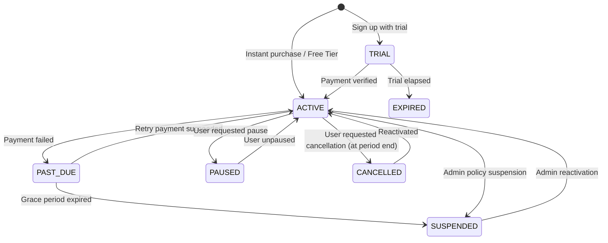

# 27. Subscriber Management & Customer Portal Platform Architecture

## 1. Overview & Core Philosophy

CodeGuard is built as a multi-tenant enterprise code governance SaaS platform. Rather than hard-coding plans into application business logic, CodeGuard implements a **Dynamic Entitlement & Benefit Engine**.

The core hierarchy separates identity from tenancy and entitlement:

```text
Identity (User)
      ↓
Membership / Role (Owner, Admin, Member, Read-Only)
      ↓
Customer Account / Organization (Individual, Pro, Organization)
      ↓
Subscription (Basic, Pro, Enterprise — Active, Trial, Cancelled)
      ↓
Entitlements & Usage Quotas (Features, Limits, Quotas)
      ↓
Application & API Access (CLI, Webhook PR Reviews, AI Reviewer, Admin Controls)
```

---

## 2. The 3 Core Product Tiers

| Tier | Target Audience | Key Capabilities | Limits / Quotas |
| :--- | :--- | :--- | :--- |
| **Basic / Student** | Students, Academic Researchers, Solo Learners | Local CLI intelligence, AST parsing, Symbol extraction, Code graph + local RAG, Zero-trust secret detection, Conventional commit linting. Offline/local only. | 1 User, 3 Repositories, 100 Local Reviews / mo, 5 GB context cache |
| **Pro** | Senior Developers, Freelancers, Consultants | Everything in Basic + GitHub/GitLab Cloud integration, Automated PR reviews on push, Google Gemini 3.7 AI code reviewer, Branch protection gatekeeper, Human approval enforcement. | 1 User, 10 Repositories, 100 Cloud PR Reviews / mo, 500 AI Deep Reviews / mo, 50 GB storage |
| **Organization / Enterprise** | Engineering Teams, Fintech, Healthcare, Enterprise Orgs | Everything in Pro + Central Organization Account, Multi-seat developer provisioning, Team RBAC, Centralized multi-repo policies, CODEOWNERS rules, Admin platform, Audit logs, 24/7 dedicated support. | Scalable: 50+ User Seats, 50+ Repositories, 2,000 PR Reviews / mo, 5,000 AI Reviews / mo, 500 GB storage |

---

## 3. Centralized Entitlement Engine

The `EntitlementEngine` (`@codeguard/policy-engine`) provides unified authorization and consumption checks across all microservices and API routes:

```typescript
// Check boolean feature access
const canUseAI = await entitlementEngine.has(customerId, 'AI_CODE_REVIEW');

// Check limit & remaining capacity
const seatCheck = await entitlementEngine.canConsume(customerId, 'USER_SEATS', 1);
if (!seatCheck.allowed) {
  throw new Error('Seat limit reached. Upgrade to Enterprise.');
}

// Record consumption
await entitlementEngine.recordUsage(customerId, 'MONTHLY_PR_REVIEWS', 1);
```

### Entitlement Types
- `BOOLEAN`: Feature flags enabled or disabled per plan (e.g. `GIT_INTEGRATION`, `AI_CODE_REVIEW`).
- `LIMIT`: Fixed capacity bounds (e.g. `USER_SEATS: 50`, `REPO_LIMIT: 10`).
- `QUOTA`: Resetting consumption metrics per billing cycle (e.g. `MONTHLY_PR_REVIEWS: 2000`, `MONTHLY_AI_REVIEWS: 5000`).
- `TEXT` / `ENUM`: Plan tier strings or service levels (e.g. `SUPPORT_TIER: "PRIORITY"`).

---

## 4. Subscription Lifecycle State Machine



---

## 5. Billing Provider Abstraction

The billing system decouples payment gateways from domain business logic through `PaymentProvider`:

```text
PaymentProvider Interface
      ├── MockPaymentProvider (Local dev & CI test harness)
      ├── StripePaymentProvider (Credit cards, Apple Pay, SEPA)
      └── RazorpayPaymentProvider (UPI, NetBanking, Cards)
```

---

## 6. Multi-Channel Notification Architecture

The `NotificationDispatcher` manages targeting across audiences:
- **Everyone**: Broadcast to all active users.
- **Customer Type**: Target Students, Professionals, or Organizations.
- **Plan Tier**: Target Basic, Pro, or Enterprise subscribers.
- **Specific Organization / Customer**: Direct critical alerts or invoices.

---

## 7. Security, Tenancy & Support Impersonation

- **Tenant Isolation**: Every SQL query is filtered by customer or organization ownership.
- **Secure Support Impersonation**: Admins must provide an explicit justification reason, a warning banner is prominently rendered, and an immutable audit log entry is written.
